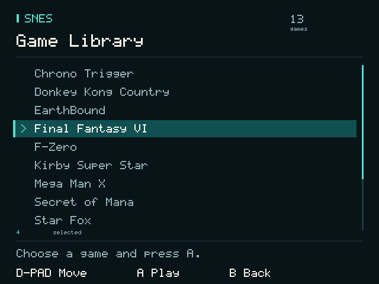

# DIIUM D-R35: device findings and SNES platform

Source, hardware investigation and a working SNES-only launcher/runtime prototype for one tested D-R35. This device runs **embedded Linux on a single Cortex-A7**, with limited RAM and vendor display/scaler interfaces. It is not an Android/RetroArch port.

The project replaces the launcher/runtime in userspace while retaining the working kernel and display driver. It also preserves the earlier SNES Plus adapter and diagnostic tools, so successful work and failed hypotheses remain reproducible.

## Current status — 2026-10-13

- **Scalar/NEON policy designed, no recoding:** state/operation/layout and setup
  reuse select a kernel family; mask density selects payload within it. Existing
  peak counts give Meteor3971-3977 sparse opportunities, but supplying the full
  20% margin needs1.13-1.16us net per hit before guard costs. Quasar needs other
  levers. Audit full-width scalar clip dispatch, opaque OBJ depth merges and
  preserve distinct sprite test/write depths. Native crossover prices remain
  missing; no build, replay or card access. [Rules and predictions](docs/snes-ppu-scalar-neon-selection.md).
- **Combined1 returned; analysis only:** all48 runs archived and identities/FAT
  verified;21 complete,27 native PCM failures. Latest completes6/8 contexts in
  both orders; Meteor/Quasar still fail. Worst16 main+worker CPU averages17.85-
  17.97ms and17.41-17.46ms respectively;20% margin needs4.50-4.62ms and4.06-4.11ms
  additional reduction before other costs. Quasar's worst load shifts later,
  where sprite activity roughly doubles. Recommend a shared scalar/NEON PPU
  backend covering BG/OBJ visibility and composition, selected by state/span.
  No code changes, new build, card writes or rearm; marker consumed. Older armed
  bullets below are historical. [Return and design](docs/snes-combined-return-and-ppu-design.md).
- **Window batching is already in the experimental test:** all three combined1
  cores include ability2's generalized scanline Window2 patch. The old78.97%
  figure measures fewer renderer entries, not total CPU saving; production
  promotion remains pending. New offline fusion reuses visibility results,
  shares band/palette setup and combines sparse stores with selected hidden-tile
  rejection. Quasar avoids4410 index rows per heavy call while Meteor retains
  3978.5625 sparse rows.90000 exact replay comparisons pass across prototypes
  and observer refinement; A7 costs remain unmeasured, current I: test unchanged.
  [Composition, negative case and evidence limits](docs/snes-fused-toolbox.md).
- **Meteor/Quasar workback, offline:** new exact census separates their costs:
  Meteor8182 partial rows versus Quasar741. A selective plain-row scalar path
  handles3978.5625 one/two-pixel Meteor rows per heavy call versus132 Quasar;
  retain NEON for dense rows. Exact signed mask widening and plain-state snapshots
  avoid a broad prototype's math register-pressure risk. Quasar instead offers
  570/849 fully hidden4bpp tiles to an observer-only early-reject probe versus
  Meteor90.3125/2743. 18000 replay calls,387072 scalar tile cases and32768 canonical
  mask fixtures pass; no A7 time inferred. Current combined1 test is unchanged.
  [Mechanisms, rejected shortcuts and savings thresholds](docs/snes-meteor-quasar-partial-workback.md).
- **Combined1 measurement armed on I:** archive-first return
  preserves 5,834 files and all 91 prior payloads; FAT is clean. Prior combined
  completed five of eight failure contexts in both repeats; Holy, Meteor and
  Quasar still failed. New48-run suite compares original, prior combined and
  latest combined in two reversed orders across eight cases; every frame/audio
  retained, final worker/PCM accounting included. All57 new payloads independently
  read back;5,833 prior files protected; final FAT clean. Source9633be6 pushed
  before installation. Cold boot automatically, no B; allow20-25 minutes until
  stock returns. Actual A7 savings/headroom pending, production gate false.
  [Test](docs/snes-combined-test.txt), [design](docs/snes-combined-measurement.md),
  [prior return](docs/snes-fullpaths-return.md). Older status bullets below are
  historical stages and forecasts superseded by this returned evidence.
- **Shared renderer candidate qualified offline:** all eight staged failures
  use the common band path. It handles2,058–10,055 former tile calls per heavy
  call with103–378 band entries, reuses palettes within each background call and
  directly stores fully visible depth rows. Final variant passes43,200 original
  replay calls,129,024 scalar tile cases and3,584 repeated-palette cases. Preserve
  a generic prototype that added per-row blend calls as a rejected design.
  New A7 prices/headroom remain unknown; no card access or staged payload change.
  [C review, per-effect work and break-even conditions](docs/snes-common-renderer.md).
- **Pearl workback, offline:** main BG3 spends most visited rows behind higher
  priority pixels. An early depth test removes 4,763 tile preambles per heavy
  call; a sole-layer subscreen path accelerates 4,569 opaque rows. Constant-color
  band filling is inapplicable here. Original-output qualification and independent
  tile fixtures support the mechanisms; A7 unit costs and comfortable headroom
  remain unproven. External A7/ARM emulator implementations were checked for
  reusable patterns. Staged fullpaths1 remains unchanged.
  [Mechanisms, break-even prices and evidence gaps](docs/snes-pearl-workback.md).
- **Fullpaths measurement armed on I:** 100 automatic runs compare baseline,
  fixed-color rows, subscreen composition, DSP removal and their combination
  across ten contexts in two reversed orders. New combination exactness,
  actual controller, native fault/retry/deficit and wrapper checks pass offline.
  Every frame retained; RAM logging and explicit pacing accounting measure
  included costs. Fresh 5,021-file archive, 5,020 protected old files and 91
  verified payloads; final FAT clean. A7 saving/headroom pending, production
  gate false. Cold boot starts automatically; allow about 40 minutes.
  [Measurement design](docs/snes-fullpaths-measurement.md),
  [physical instructions](docs/snes-fullpaths-test.txt).
- **Every frame required; three new paths qualified offline:** fixed-color row
  batching, true-subscreen composition and unused DSP interpolation removal
  preserve pixels/PCM/state in 129,600 comparisons. Fixed rows also pass 406
  bounded animation overlays and an independent negative-X clipping oracle;
  the oracle exposes and verifies the correction of an earlier local candidate.
  A proposed 20% capacity margin needs up to 5.354 ms saving in matched tails.
  New A7 prices and universal coverage remain missing; no hardware-impossibility
  proof, production gate false, no card writes or rearm.
  [Mechanisms, calculations and evidence gaps](docs/snes-full-fidelity-paths.md).
- **Ability3 returned; I: unarmed:**same6/18 complete and12 native PCM failures.
  Fixed-math cache does not close deficits; matched CPU gains are small and
  comparable to controls, with some regressions. Preserve it as a negative result;
  ability2 remains the source baseline.5,021 files archived,79 payloads and4,811
  protected prior files verified, FAT clean,0 card writes. Next boot stock.
  [Measured verdict and next evidence](docs/snes-ability3-return.md).
- **Historical ability3 staging:**6/18 ability2 cases complete;
  12 native PCM failures remain. Aligned A7 CPU savings are1.88ms Holy,
  1.74ms Meteor,2.01ms Ultima and2.57ms GrandTrain; Ultima/GrandTrain now finish.
  Bio Blast/Confuser stay clean. New fixed-operand math-palette reuse passes
  43,200 exact replay calls,2,097,152 scalar palette checks and actual runner/
  native/wrapper checks. Physical saving pending, production gate false.
  [Return](docs/snes-ability2-return.md), [new test](docs/snes-ability3-test.txt),
  [mechanism and thresholds](docs/snes-ability3.md). Fresh4,813-file archive,
  4,812 protected files,79 verified new payloads and clean final FAT.
- **Historical ability2 staging:**18 automatic cases (~6–7 minutes),
  including all11 failed effects, five Rages and Terrato/Bio Blast/Confuser
  controls. Separate counter-free generalized Window2 renderer passes48,000
  exact comparison calls and18 actual-runner cases offline. Matched tails remove
  repeated setup in Holy/Meteor/Ultima/GrandTrain; seven effects remain unresolved.
  Archive4,605 files, protect4,604, verify79 payloads and clean FAT. Physical
  savings pending; production gate false. [Instructions](docs/snes-ability-regression-test.txt),
  [calculations and remaining mechanisms](docs/snes-ability-regression.md).
- **Ability suite returned:** all400 cases attempted,376 full windows completed,
  24 native PCM failures grouped into11 effects. All27 summons fired; Siren,
  Bahamut and Carbunkl failed. Bio Blast/Confuser completed. New archived contexts
  pass13,200 offline graphics/PCM/state comparisons; A7 deficits remain measured,
  candidate savings unpriced. Archive/FAT/progress verify; I: unarmed,0 writes.
  [Results and measured targets](docs/snes-ability-suite-return.md).
- **Historical staging: automated ability suite armed on I:**400 independent command
  fixtures reuse the successful Confuser core, with valid heal/revive/cure/buff
  targets, real inputs, normal audio/display and deferred per-case evidence.
  About2h15 plus reset/flush time; no B press. Original progress and576 prior
  files protected; physical result pending. [Instructions](docs/snes-ability-suite-test.txt),
  [scope, predictions and limits](docs/snes-ability-suite.md).
- **Ability lab built locally:** isolated super-unit profiles,30 private checkpoints
  and124 real-command casts qualified offline. All54 spells,24 Lores,27 summons,
  eight Magitek and eight Tools pass; broader skill/context and A7 speed coverage
  remain open. ROM/progress/card untouched. [Lab and limits](docs/ff6-ability-lab.md).
- **Confuser candidate returned successfully:** two fights reported beautiful;
  7,119 calls/drawings, zero audio errors,59.994 active calls/sec and orderly exit.
  Card archived/FAT clean/unarmed; original progress intact. [Return](docs/snes-confuser-gameplay-return.md).
- **Systematic effect screen:**406 animation records pass current and generalized
  window renderers;567,000 exact comparisons plus original clipping oracle.
  Shared Holy/Meteor/Ultima window inefficiency is corrected offline. El Nino,
  glow and Mode7 remain risks to measure, with no new A7 crash/speed guarantee or
  card change. [Coverage and findings](docs/ff6-effect-safety-screen.md).

Historical staging and earlier investigation states follow:

- **Confuser gameplay1 staged on I:** user authorizes an experimental manual
  one-shot with counter-free BG3 batching and refined half-add. Normal controls,
  latest copied test SRAM/snapshot and separate saves; original files preserved.
  Final4,800 output comparisons and runtime/native/wrapper seams pass, with clean
  FAT and protected readback. New A7 savings remain unmeasured; physical return
  pending. [Test](docs/snes-confuser-gameplay-test.txt),
  [prediction and setup](docs/snes-confuser-gameplay.md).

- **Confuser investigated offline:** the combined core's BG1-only batching falls
  back on Confuser's BG3 circle, alongside growing half-add/depth work. A separate
  BG3 extension removes2,028 tile calls/effect call; a refined exact-math shortcut
  covers4,042 half-add rows.10,800 output comparisons and original clipping/math
  oracles pass. Physical tail requires0.803ms minimum, with a1.020ms local PCM
  throughput proxy; incremental A7 prices remain missing. No card changes or
  new A7 test during that analysis; later authorized staging is above.
  [Findings and predictions](docs/confuser-rendering-investigation.md).

- **Manual combined-renderer gameplay returned:** Bio Blast seemed fine; Confuser
  stopped after225s with native PCM errno77/SETUP. Archive/hash verification
  and readonly FAT pass; original progress remains preserved and card unarmed.
  [Return](docs/snes-combined-gameplay-return.md),
  [measured gate and setup](docs/snes-combined-gameplay.md).

- **A7 pair1 physical return:** all6 combined passes finish; all6 baselines stop with PCM errno77. Both full500-call combined replays keep stable reserve, render every frame and complete effect/recovery. Aligned effect calls save~2.9ms CPU/~3.2ms core wall. This closes the bounded replay deficit; longer gameplay and vendor lifecycle remain unqualified. Card archived/hash-verified/FAT clean; no writes or rearm. [Measured return](docs/snes-a7-pair-return.md).

- **A7 pair1 staged,2026-10-11:** I: is now the test card. A separate automatic12-pass ABBA suite compares shipping1.19 with window batching/palette tables/prefix validity, including later aligned states. No nested core clocks or work counters; native audio/display stay active.6,000 output comparisons and consuming-client/wrapper checks pass. Archive/FAT/protected hashes verify; production files and progress remain exact. Physical performance is pending. [Test](docs/snes-a7-pair-test.txt), [design and limits](docs/snes-a7-pair-suite.md).

- **Creative offline renderer experiments,2026-10-11:** new counters reveal8,341 fewer plain tile calls/frame under window batching, despite identical row counts. A small palette-table/direct-NEON alternative removes RGB-cache traffic; constant-time prefix validity replaces row scans. Six Bio Blast comparisons plus two broader checks pass12,000 frames; original clipping and prefix oracles pass. No A7 speedup/install claim. [Tested mechanisms and revised cost gate](docs/bio-blast-clever-renderer.md).

- **Backward cost model,2026-10-11:** archived controls and C paths favor growing row/compositor work and possible tile-dispatch fragmentation; tile decodes stay flat and added materialization payload predicts only17us growth. Scalar clipping is real but requires6.45..12.33us saving per requested row to close the floor. Best held-out count model still misses0.84..0.85ms. [Ranked causes, thresholds and missing evidence](docs/bio-blast-backward-model.md). Analysis only; no new diagnostic or card changes.

- **A7 cost1 returned, unarmed:**13 physical passes reproduce the PCM stop before dense frame320. Partial warm setup credit0.231ms minus extra rows0.150ms and short helpers0.115ms predicts a0.033ms loss, far below the1.514ms saving needed. Deep phase clocks materially perturb the test; full candidate cache/span coverage remains incomplete. Archive, clean FAT and141 protected hashes verify with0 card writes. No new build/install. [Measured costs and prediction](docs/snes-a7-cost-return.md).

- **ROM-derived Bio Blast investigation:** the3 MiB ROM rebuilds byte for byte, with103,538 native instruction addresses mapped into private C and a readable script/wave model.178 actual wave-kernel calls match that model. Circular-window edge writes, rather than scroll writes, repeatedly flush the renderer. A separate scanline-window patch passes524,288 clip states and3,600 comparison frames; effect PPU updates fall78.97%, but color preparation rises34.58%. No physical speedup/audio fix is claimed and this candidate is not installed. [Cause, code and tests](docs/ff6-bio-blast-cause-map.md).

- **Focus1 returned and unarmed:** Bio Blast still fails on the unchanged1.19 core. Sampled PPU CPU rises5.741 ->8.904ms; APU-inclusive stays4.529..4.898ms. The core's clock model predicts735.948 sink frames/call; late physical production is38,481/sec against44,100Hz.60 runtime/progress and49 lab files are archived with clean FAT and unchanged private progress. Complete effect/recovery reserve and candidate unit costs remain unmeasured; the window candidate fails the written prediction gate. [Effect budget and scorecard](docs/snes-focus-1-return.md), [exact resume](docs/handoff-2026-10-10.md).

- **Both Vesper boot screens installed and verified:** user confirms Vesper static -> Vesper animation -> stock launcher. Both complete 8 MiB flash reads match the expected image byte for byte. Original SD startup restored; firmware update trigger absent, stock/progress hashes preserved, FAT clean. Cost1 has returned; all tests are unarmed. External recovery unqualified; audio unresolved. [Verified result](docs/vesper-static-firmware-update.md).

- **Previous second-animation baseline verified:** before the first-screen update, both complete 8 MiB reads matched the expected programmed image byte-for-byte after removing Code.bkp. Normal SD init was restored, stock/progress hashes were preserved and FAT was clean. This is the verified baseline for the current replacement. [Previous verified return](docs/vesper-flash-verification.md), [accepted animation update](docs/vesper-sd-firmware-update.md), [current handoff](docs/handoff-2026-10-09.md).

- **MVP1.18 audio failure remains unresolved; FAT recovery completed:** approved repair preserves14 lost chains and all412 previously readable files. Missing1.18 session/PCM reports are recovered; verified pre-test SRAM replaces the empty current file. Fresh health and strict archive checks pass; exact release/stock/snapshots survive, both tests unarmed. [Recovery and current resume](docs/fat-recovery-2026-10-09.md).
- **Vesper artwork and earlier SD-stage test:** cyan feathered wing-V/heart on black with18-frame loading dots. The earlier one-shot displayed after both stock screens and remains consumed/unarmed. The subsequent internal updates above now replace both original boot screens. [Artwork and earlier receipt](docs/vesper-boot.md).
- **MVP1.17 first launch succeeded:**35,763 calls at59.978/sec overall, zero held drawings/duplicate callbacks, snapshot load worked. Terra's Magitek armor Bio Blast ended with an audio error/our library after a transient renderer/production deficit. First-launch isolation worked in this run; repeated cold-boot reliability is not established. User withdrew expected driving snow after checking playthroughs. [Return](docs/snes-mvp-1.17-return.md), [diagnostic isolation](docs/snes-mvp-1.17.md).
- **MVP1.16 returned very playable:** successful retry sustained31,601 calls at59.985/sec, combat/party menu/game save/snapshot load worked. Its first launch failed during live wrapper diagnostic activity, removed in1.17. [Return](docs/snes-mvp-1.16-return.md), [renderer repair](docs/snes-mvp-1.16.md).
- **MVP1.15 returned with audio failures:** both retained snapshot loads succeed, then19/18 calls exhaust production margin. Ordinary expensive-scene main CPU is about18ms, wall19.3–19.5ms; sampled PPU about10ms. Exact payload and21 game-progress files match; no new whole-device poweroff established. First-attempt detailed history was overwritten by retries. [Return](docs/snes-mvp-1.15-return.md), [raster census](evidence/2026-10-06/raster-work-census/analysis.json).
- **MVP1.13 return established sustained underproduction:** 26/230 calls, successful snapshot on retry, exact payload and all 20 private progress files unchanged. Fault history and kernel READ_ALL survive. The retained expensive phase produces about 37k accepted frames/sec against a negotiated 44.1k sink, before three 128-frame application-pointer advances and SETUP. Starvation is the leading trigger; exact vendor stop behavior remains unresolved. [Return](docs/snes-mvp-1.13-return.md), [budget review](docs/execution-budget-review.md).
- **Hardware confirmed:** MVP 1.5 boots into its library, starts Final Fantasy VI and loads the imported save state. All four directions work in the launcher and game.
- **Returned MVP 1.5:** 23,872 core calls, 2,826 held drawings (11.838%), no reported audio-write errors. The user heard rare random crackles in normal play and occasional lag. Full rendering and uninterrupted playback remain the target.
- **MVP1.6 failed its physical run:** very choppy sound, slow movement, clean-looking graphics, then the whole device powered off. The returned build hashes match; originals are intact and the one-shot is consumed. No fresh session totals survived. Do not re-arm this release unchanged. [Failure review](docs/snes-mvp-1.6-failure.md).
- **MVP1.7 returned without a crash:** reached a Save Point, saved and exited normally, but remained laggy; FF6's party menu helped partially. Fresh counters show 7,068 calls, zero holds, about 54.63 emulation calls/sec of active-loop time and 31.08% of calls definitely over budget. That return was archived read-only before updating; new SRAM is preserved. Missing `head` left diagnostic gaps, corrected and tested for1.8. [Return review](docs/snes-mvp-1.7-return.md).
- **MVP1.8 returned with clicking and whole-device power-off:** fresh checkpoint records1,648 calls, zero held drawings and about57.93 calls/sec of active-loop time. Saved progress and stock/hook hashes were intact and the returned card was unarmed. Shutdown cause remains unknown. Firmware also lacks `sed`; the capture fix passes without `head` or `sed` and is incorporated in1.9. The exact returned core passes10,000 output-equivalence frames. [Return review](docs/snes-mvp-1.8-return.md), [implementation](docs/snes-mvp-1.8.md).
- **Working reference:** v11 SNES Plus adapter in the vendor launcher. Intro/Narshe/wind listening tests were clean with adaptive internal drawing suppression.
- **Not established:** cold first-launch reliability, every scene's full speed/effect fidelity, independent panel scanout cadence, a controlled speed comparison with v11, broad emulator compatibility, usable hardware GPU acceleration, or factory-card compatibility of the current installer.
- **Hardware lab1 returned successfully:** stock launcher resumed; all four display phases complete240/240 jobs, including a12ms CPU load, while audio remains buffered in samples. NEON wins the tile fixture; the experimental color cache loses.5ms deadlines average5.48ms late, making timer-polled pacing a concrete next target. Text readability and transition clicks are recorded. Its return was archived and its one-shot consumed. [Physical findings](docs/platform-lab-1-return.md), [scope](docs/platform-lab.md).
- **Lab2 returned complete, with clicks:** all nine PCM byte targets and all four 240-drawing phases complete, but the user hears clicks between and during tests. All short timeout methods average about 10ms despite timer-slack reduction; audio readiness wakes around 2.77ms in the smallest-fragment transport. Burst production exceeds the available playable reserve. All 973 scaler statuses contain FRAME_DONE; the ten-sleep fallback never runs. Archive verifies 41 MVP/49 lab files and 20 protected private entries. Card unarmed, zero writes. [Physical findings](docs/platform-lab-2-return.md).
- **Source research leads1.9:** Linux 4.19 OSS source exposes partial-fragment staging and explains why POST/zero-delay/RESET does not qualify complete tail playback. Native ALSA defines negotiation, priming, device-driven refill, stream-state observation and drain; its playback node exists on this device. That contract is now implemented with one coherent PCM owner. Exact vendor behavior and full-speed FF6 remain unqualified. [Interface research](docs/platform-interface-research.md).

## Start here

| Topic | Document |
|---|---|
| Broad passive inventory and active test catalog | [Device survey suite](docs/device-survey.md) |
| Hardware, OS, memory, clocks, display, audio, UART | [Device findings](docs/device-findings.md) |
| Splash handoff, GPIO map, clocks, ABI and lifecycle | [Boot and hardware contracts](docs/boot-and-hardware-contracts.md) |
| Source, dependencies, checks, installation and recovery | [Build and test](docs/build-and-test.md) |
| What each investigation proved or ruled out | [Investigation history](docs/investigation-history.md) |
| Runtime ownership and next engineering work | [Architecture](docs/architecture.md) |
| Current A7 core/runtime build and physical acceptance | [Focus1 diagnostic](docs/snes-focus-1.md), [MVP1.19 return](docs/snes-mvp-1.19-return.md), [ROM-derived window experiment](docs/ff6-bio-blast-cause-map.md) |
| Hardware resources, measured costs and remaining opportunities | [Capability roadmap](docs/hardware-capability-roadmap.md) |
| Latest infrastructure result and researched audio contracts | [Lab2 return](docs/platform-lab-2-return.md), [interface research](docs/platform-interface-research.md) |
| Concrete Cortex-A7 core and pipeline proposal | [Full-speed SNES plan](docs/full-speed-snes-plan.md) |
| Forward A7 renderer implementation | [MVP1.8](docs/snes-mvp-1.8.md) |
| Latest gameplay and remaining failure/effect limits | [MVP1.19 return](docs/snes-mvp-1.19-return.md) |
| Current failure model and proposed engineering direction | [Execution-budget review](docs/execution-budget-review.md) |
| Logging retry implementation | [MVP1.7](docs/snes-mvp-1.7.md) |
| A7 full-render implementation and failed test | [MVP1.6](docs/snes-mvp-1.6.md), [failure review](docs/snes-mvp-1.6-failure.md) |
| Actual shipped emulator identities and limitations | [Core inventory](docs/core-inventory.md) |
| Evidence preservation and future changes | [Maintenance](docs/maintenance.md) |

The particularly expensive discoveries are written down explicitly: **finish the vendor splash handoff before opening a display; compare libc clocks with direct kernel clocks; translate GPIO through the stock input callback's mask table; retain DMA buffer ownership until completion.**

Rendered UI preview; this is not a handheld photograph.

## Repository layout

- `build/snes-mvp/`: launcher, runner, UI, board backend, timing, state importer and checks.
- `build/`: current and historical adapter/probe source, analyzers, builders and guarded installers. Historical installers are not generic deployment tools.
- `evidence/`: selected returned logs, analysis, recovered ABI data and verification, with a provenance/hash manifest.
- `docs/reference/`: dated deeper hardware/runtime/core reviews. These are proposals or historical reviews where marked; current corrections in the guides take precedence.
- `releases/`: owned versioned ARM executables, wrappers and verification. Games, private saves, vendor driver/core/runtime libraries and full firmware backups are not included.

Only one hardware unit has been tested. Confirm the identity and software hashes of another unit before applying recovered private ABIs. A filename or identical product label does not establish matching firmware.

## Contributing

Preserve the known working path, make bounded changes, record physical results separately from QEMU checks, and update the relevant guide and changelog in the same commit as the fix. See [maintenance](docs/maintenance.md). Code and dependencies retain their own notices; see [NOTICE](NOTICE.md).
