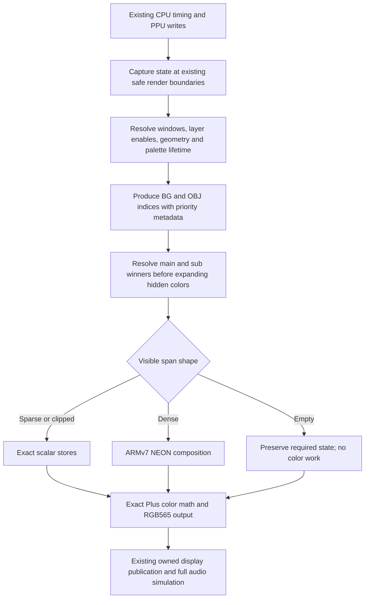

# Combined1 return and a shared A7 renderer design

2026-10-13, America/Chicago. Analysis and design only. No emulator code changes,
new builds, replay runs, card writes, installation or rearm.

## Returned evidence

Private archive: `device-evidence/a7-pair-before-20261014T021915Z` (UTC name).
All6249 retro files,1650726005 bytes, copied and hash checked before analysis.
Read-only CHKDSK reports clean FAT/serial11EB-1465. All57 installed payloads,
dispatch, boot binaries, production core, original ROM ZIP and prior protected
progress verify. Compared with5834 pre-install files, only the intentionally
installed dispatch and runtime swapfile differ. No armed marker remains.

All48 epochs ran without user abort.21 completed1200 frames;27 ended with
`Audio publication failed: File descriptor in bad state`. Their PCM histories
record26 `SYNC_OBSERVE` and one `WRITEI_FRAMES` failure, all errno77/SETUP,
rather than a captured C signal fault.
Every completed epoch submitted/flipped all1200 frames, with zero holds, valid
sampled pointers and final software PCM/worker accounting. This is bounded
runtime evidence, not recorded physical speaker/panel acceptance.

Each cell below is complete windows out of two. The baseline already contains
generalized Window2 batching. Latest is the installed common-band v3 combination,
not the newer offline fused-toolbox candidate.

| Context | Window baseline | Prior combination | Latest | Latest added core-call CPU saving, aligned old interval |
|---|---:|---:|---:|---:|
| Pearl/Holy |0/2|0/2|2/2|1.071-1.245ms|
| Meteor |0/2|0/2|0/2|0.350-0.513ms|
| Meltdown |0/2|0/2|2/2|0.200-0.383ms|
| Siren |0/2|2/2|2/2|0.530-0.646ms|
| Bahamut |1/2|2/2|2/2|0.030-0.201ms|
| Carbunkl |0/2|2/2|2/2|-0.075 to -0.055ms|
| Quasar |0/2|0/2|0/2|0.446-0.563ms|
| Lullaby Rage004 |0/2|2/2|2/2|0.081-0.289ms|

All prior-to-latest old intervals contain their full16 matched call indices.
Some baseline comparisons are partial and must not receive full-interval credit.
Core-call CPU includes existing callbacks and the identity observer. Observers
remain included; no calibration is subtracted. Two orders show finite-run
variation, not a confidence interval or isolated per-operation unit price.
Carbunkl's small negative result prevents claiming every added path is a win.
Prior Meltdown completed both orders in the preceding return but neither here:
passing once is weaker than a measured margin across repeated conditions.

## Separate CPU demand from overlapping wall time

The existing service proxy adds worker CPU to unpaced step wall. That intentionally
conservative proxy can count worker execution twice when it overlaps core wall.
It must not become an irreducible hardware requirement.

For a second view, sum `main_step_cpu_ns` and the differences between successive
audio/display worker CPU samples. These are distinct thread CPU clocks on this
single CPU. This keeps observer costs but avoids adding overlapping wall time.
Samples bracket nearby instants; interval aggregates are more useful than an
individual call. Other processes/kernel work and final unsampled cleanup are
not all represented in the interval sum. Final worker residuals remain separately
accounted in the original analyzer. Neither view is a lower bound on optimized
future code.

358416 emulated master clocks imply16.688154ms per call;20% headroom means
13.350523ms. The native PCM quota is99.99962-99.99999% of the cycle-derived
expectation across epochs. No CPU frequency interface was exposed (all readings
-1); no assumed MHz, cycles or QEMU time enters these calculations.

Search the already recorded latest runs for the highest mean16-call CPU interval
after120 warmup calls, stopping before the first invalid pointer:

| Context | Worst16 timed thread CPU, two orders | Above16.688ms deadline | Reduction to13.351ms target |
|---|---:|---:|---:|
| Pearl |16.249-16.282ms|below by0.406-0.439ms|2.899-2.932ms|
| Meteor |17.850-17.973ms|1.162-1.285ms|4.500-4.623ms|
| Meltdown |16.636-16.814ms|below0.052 to above0.126ms|3.285-3.464ms|
| Siren |16.359-16.567ms|below by0.121-0.329ms|3.009-3.217ms|
| Bahamut |16.652-16.759ms|below0.036 to above0.071ms|3.301-3.409ms|
| Carbunkl |14.492-14.581ms|below by2.107-2.196ms|1.141-1.230ms|
| Quasar |17.415-17.462ms|0.727-0.773ms|4.065-4.111ms|
| Lullaby |14.828-15.190ms|below by1.498-1.861ms|1.478-1.839ms|

These selected finite-window means are design targets, not p99 guarantees.
The published aligned-window receipts retain distributions. All21 complete
epochs still fail the conservative all-call20% criterion. Completion means the
effect survived its burst/recovery; it does not establish comfortable capacity.

Meteor first develops invalid sampled pointers at frames408/413 and terminates
after414/420 calls. Quasar first diverges at540/524 and ends after549/536 calls.
Do not certify reserve from later queue values. Before that divergence, the
maximum cumulative unpaced-wall excess over the nominal budget is44.37-44.49ms
for Meteor and43.14-43.36ms for Quasar (about1903-1962 sink frames at44.1kHz).
This is a workload-debt model, not exact hardware reserve. Last valid reported
hardware queues are881/849 and746/875 frames respectively. The sequence supports
burst debt followed by native-audio failure; it does not explain the vendor's
pointer discontinuity or prove throughput is its sole trigger.

## Where the workload actually moves

Quasar's old comparison window was427-442. Its worst sustained current windows
are508-523 and514-529. Re-index existing exact replay logs at those frames;
no new replay or build is needed. These are offline work counts aligned to the
physical state, not on-device subphase timings:

| Quasar row events per call | Old427-442 | Later514-529 |
|---|---:|---:|
| Main OBJ active |664.4375|1246.5|
| Sub OBJ active |577|1180.0625|
| Main BG1 math active |4351|3955.4375|
| Common background partial |741|1105.5|

Sprite activity roughly doubles while this background math population shrinks.
That ranks OBJ traversal/coverage and partial overlap as an additional late-cost
lead. It does not price sprite CPU or establish causality by counts alone.
Quasar still offers570 fully hidden4bpp tiles in both late windows; the offline
fused candidate retains that opportunity, with4411 probe rows that must be paid.
Its late sparse-store opportunities are174.125-189.625 rows, not the earlier132.

Meteor's current peaks remain dominated by the earlier shape: common background
partial rows8152.625-8177.1875, with3971.3125-3977 sparse one/two-pixel rows in
the offline candidate. Those need less terminal read/merge/store work, rather
than a faster subtraction formula. The detailed per-mode mask census was sampled
only in the older interval; do not pretend to have that detail at every new peak.
The current return has phase clocks disabled, so no fresh PPU-exclusive or
per-kernel A7 timings can be inferred by dividing total CPU by these counts.

## Recommendation: redesign the rendering backend around PPU state

Proceed to a design for a common scalar/NEON A7 backend inside2005 Plus, preserving
its emulated execution and register/memory semantics. The current code already
compiles natively for ARMv7-A and uses NEON. The larger opportunity is its data
flow, intermediate representation and work lifetime. Effect names belong in the
regression corpus; implementation selection should depend on PPU state and span
shape. This recommendation authorizes no implementation in the present task.

Proposed flow:

1. **Separate state ownership from drawing.** Retain CPU/APU scheduling,
   VRAM/CGRAM/OAM invalidation, sprite evaluation/status effects and render
   barriers. A delayed operation cannot read newly written VRAM or palette data
   for an earlier row. Use immutable/versioned state or finish the old segment
   before mutation. Preserve the pinned Plus timing contract; this is not a
   claim to add dot-accurate hardware behavior through a renderer rewrite.
2. **Use shared row/span metadata for BG and OBJ.** Priority, transparency,
   windows and main/sub eligibility should identify useful output before RGB
   expansion and color math. Preserve priority ties, OBJ order, limits and
   overflow flags even when hidden color work is omitted. Retain separate
   main/sub winners; they cannot generally share a completed image.
3. **Choose scalar and NEON by shape.** Empty spans avoid payload work; sparse
   pixels and short edges use scalar code; dense runs use specialized vector
   loops. Keep mode/state decisions outside pixel loops where possible and
   reuse loaded masks. More NEON instructions are not inherently less work.
   Target ARMv7 intrinsics and emitted A7 assembly; AArch64/SVE kernels do not fit.
4. **Keep storage bounded.** An illustrative pair of256-pixel,32-bit winner rows
   uses2048 bytes, versus448KiB for two full256x224 tagged planes. That is only
   winner storage: masks, indices, decoded tiles, fallback buffers and hires
   widths add costs. Measure the actual cache working set; do not assume this
   device's L1 sizes or declare the scratch cache-resident without evidence.
5. **Preserve exact arithmetic and independent reference behavior.** Plus's
   RGB565/green/half-subtract details must survive. A final composition pass
   could avoid repeated work, but adds tag writes/reads and cannot receive an
   automatic multi-ms credit. Keep the pinned original renderer as the oracle,
   compare a clear scalar backend and its NEON implementation against it, and
   qualify generic state classes and boundary fixtures as well as game scenes.
   Cover OBJ/clipped paths, every arithmetic mode, mosaic, Mode7, offset modes,
   direct color, hires/interlace, window combinations, cold cache and writes.

This is a backend replacement plan, not a wholesale timing-core transplant or
a recommendation to hand-write the entire PPU in assembly. Prior exact kernels
and independent fixtures remain useful components. Feature fallbacks require
explicit state/ownership boundaries; they must not silently bypass the full
render or change memory-state visibility.

## Comparable designs and what remains unknown

[Supafaust](https://github.com/libretro/supafaust) explicitly supports a
single-thread renderer. The pinned source at642d1d1 separates BG/OBJ production,
priority selection (`MixLayersSub`), and final main/sub math (`MixMainSub`). This
is a useful architecture reference, not an A7 timing result for this board.
Its `ppu_st.cpp` also lists unresolved hires/window/mode issues, and its color
representation differs: copying it would not establish exact Plus behavior.
The reviewed NEON block in `ppu_render_common.inc` implements brightness; do
not describe all its priority/color composition as a ready-made NEON backend.

[Arm's NEON reference](https://developer.arm.com/community/arm-community-blogs/b/operating-systems-blog/posts/arm-neon-programming-quick-reference)
documents the ARMv7 register/intrinsic model. Intrinsics expose vector operations,
but scheduling, spills and memory traffic still need emitted-code inspection
and real A7 measurement. Multithreading cannot provide a second core here.

Before choosing the new representation, missing evidence is current A7 BG/OBJ/
clipped/visibility/composition CPU attribution at the newly identified peaks,
tag-buffer and final-pass traffic versus eliminated work, sparse/dense crossover
costs including misses, and full-effect reserve with reliable native pointers.
Existing source counts and past failed experiments narrow these questions;
they do not price the rewrite or prove it can meet every possible SNES workload.
The honest goal is to beat the measured4.50-4.62ms Meteor and4.06-4.11ms Quasar
CPU-margin targets with added costs charged, then verify complete repeated
effects and recovery. No frames may be dropped to turn that target into a pass.

## Evidence and reproduction

Run the unchanged `build/report-combined-return.py <archive>` for the original
48-epoch analysis. Supplemental receipts use that raw `frames.csv`: timed CPU
is main-step CPU plus worker counter deltas; peak selection maximizes contiguous
16-call means after warmup and before first pointer divergence. Cumulative
unpaced debt uses `debt=max(0,debt+step-pace_wait-period)`. Existing full1200-call
PEARL/FUSED logs supply aligned work only. Receipts record source hashes and
limitations; raw ROM, states, SRAM, PCM and vendor binaries remain private.

Published bounded [return evidence](../evidence/2026-10-13/combined-return/).
