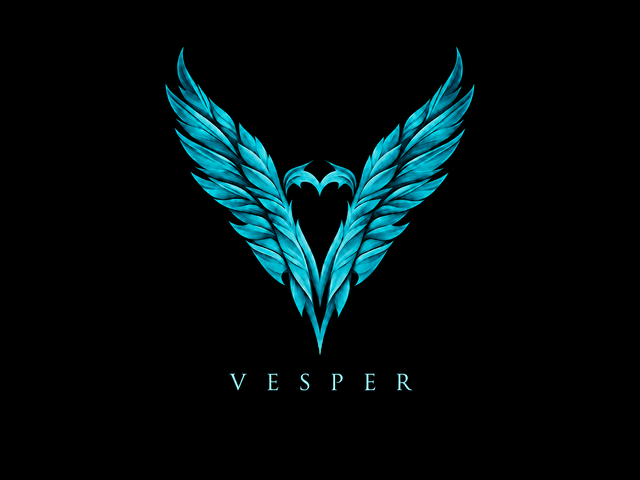

# Vesper's Wings: feather-light animation

The second artwork release replaces the three loading dots with a cyan light
sweep through the existing feathers. It starts at the lower V, climbs both
wings and fades at their tips. The heart opening, silhouette, black background
and lettering retain the accepted artwork. No new logo or lettering is generated.



The preview uses90ms per frame (1.62 seconds per loop). Physical cadence is
unmeasured; this is a reviewable candidate, not an installed firmware update.

## Native format and cost

The shipped showlogo path remains unchanged:640x480 background followed by one
sprite,18 frames, little-endian RGB565. Each moving sprite contains only the
current soft highlight band. The original loop redraws the background before
the sprite, erasing the previous band. Shader work happens at build time;
there is no runtime shader, new decoder or process.

The compressed content and ZIP headers occupy133,088 of141,940 available bytes;
8,852 bytes remain as inert padding. Raw artwork is1,021,736 bytes, within the
original2,808,092-byte allocation. The largest sprite is11,620 pixels versus
the old280-pixel dots; the unchanged background already paints307,200 pixels
per frame. That is up to11,340 additional copied pixels, approximately3.69% of
the background work. The new raw payload adds396,952 bytes compared with the
first release. Boot decode time and A7 drawing cost remain unmeasured.

Every executable byte outside the original embedded ZIP span stays exact.
The first static firmware screen and startup/display handoff are unchanged by
this asset candidate. The original release and its proofs remain intact.

## Verification and next step

The actual original ARM OpenZipU/UnzipItem routines decode the complete payload.
All18 actual ShowSprite frames match independent table composition exactly;
buffer canaries remain intact under QEMU. The nine-frame contact sheet was
visually reviewed, and all18 GIF frames are distinct. This does not establish
physical appearance, cadence, flash installation or recovery.

Authored [assets and manifest](../releases/vesper-wings-2/manifest.json) contain
no vendor executable. The data-patched executable remains private. Rebuild with:

```powershell
python build/make-vesper-wings.py --stock YOUR_PRIVATE_ARCHIVE/stock-showlogo
```

No card access, new one-shot marker, firmware trigger or flash write occurs.
The currently armed UART capture remains the next device run. A later hardware
preview/install must follow returned-log collection, archive and current boot/
firmware identity verification; historical installers are not instructions for
this candidate. The current internal animation lives in firmware, so merely
replacing the SD showlogo would not replace that internal screen.
